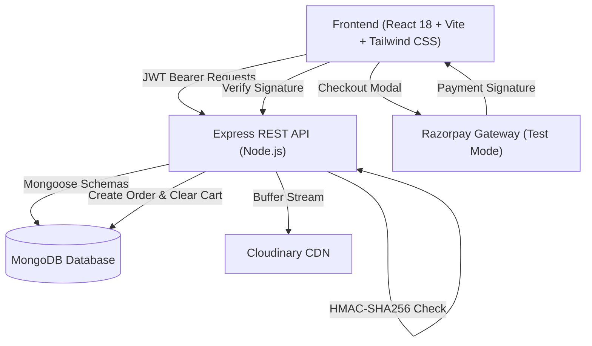

# NexStore | Full-Stack Role-Based E-Commerce Platform

[](https://nodejs.org)
[](https://expressjs.com)
[](https://mongodb.com)
[](https://react.dev)
[](https://tailwindcss.com)
[](https://cloudinary.com)
[-0C2340?logo=razorpay)](https://razorpay.com)

A production-grade, full-stack role-based e-commerce web application engineered for the **Full Stack Developer Internship** one-day technical benchmark.

NexStore strictly enforces role-based access control (RBAC) at the **database and server route level** (not merely hiding UI elements), implements direct media streaming to **Cloudinary**, handles test payments with cryptographic **HMAC-SHA256 signature verification via Razorpay**, and provides dedicated operational dashboards for **Super Admins**, **Sales Persons (Sellers)**, and **Customers**.

---

## 🌐 Live Deployments

| Component | Platform | Deployment URL | Status |
| :--- | :--- | :--- | :--- |
| **Frontend Application** | Vercel | [https://kavya-ecommerce-frontend.vercel.app](https://kavya-ecommerce-frontend.vercel.app) | `Production Ready` |
| **Backend REST API** | Render | [https://kavya-ecommerce-backend.onrender.com/api](https://kavya-ecommerce-backend.onrender.com/api) | `Production Ready` |
| **API Health Check** | Render | [https://kavya-ecommerce-backend.onrender.com/api/health](https://kavya-ecommerce-backend.onrender.com/api/health) | `Healthy (200 OK)` |

*(To connect your own live deployments, follow the [Deployment Guide](#-deployment-guide) below).*

---

## 👥 Demo Role Credentials

Pre-configured test accounts are ready for evaluation. You can also click the **"Quick Test Credentials"** buttons on the Login page to pre-fill credentials in 1 click!

| Role | Email | Password | Permissions & Dashboard Scope |
| :--- | :--- | :--- | :--- |
| **Super Admin** | `admin@example.com` | `Admin@123` | **Full control:** Manage all products across all sellers, manage users & alter roles (`admin`, `sales`, `user`), update order statuses (`placed` → `delivered`), view platform sales analytics. |
| **Sales Person** | `sales@example.com` | `Sales@123` | **Seller scope:** Add products, edit/delete **only their own** products, access Sales Dashboard, view customer orders containing their products & calculate personal revenue. |
| **Customer** | `user@example.com` | `User@123` | **Shopper scope:** Browse catalog, search & category/price filtering, manage Wishlist & Cart, execute Razorpay test checkout, view past order history. |

---

## 📋 Feature Completion Summary

| Feature | Implementation Details | Backend Enforcement & Security |
| :--- | :--- | :--- |
| **Authentication** | JWT (JSON Web Tokens) with 7-day expiration, `bcryptjs` salt rounds for password hashing before saving. | `protect` middleware extracts bearer token, validates signature, rejects expired tokens with 401 Unauthorized. |
| **Role-Based Access (RBAC)** | Dedicated roles (`admin`, `sales`, `user`). Dynamic UI navigation and route guards. | `authorize(...roles)` and `authorizeProductOwnerOrAdmin` middlewares block unauthorized calls with 403 Forbidden on the backend. |
| **Product CRUD** | Public search, category filtering, price range filter, sorting (price, newest, rating), and pagination. | Sales persons can create products and modify/delete *only their own*. Admins can modify/delete any product. |
| **Cloudinary Image Upload** | Direct buffer streaming via `multer` memory storage to Cloudinary folder. Returns secure HTTPS CDN URL. | Image files never stay on server disk. Cloudinary URL stored in DB. Direct URL fallback also supported. |
| **Wishlist System** | Toggle add/remove with instant visual heart state, database persistence per user. | Protected route `GET/POST/DELETE /api/wishlist`, unique user association. |
| **Shopping Cart** | Real-time quantity adjustments, stock availability validation, item count badge, auto-calculated subtotal. | Protected route `GET/POST/PUT/DELETE /api/cart`, checks product inventory before allowing quantity increments. |
| **Razorpay Payments** | Test mode checkout flow: Backend initializes Razorpay order (`/api/payment/create-order`), frontend opens checkout modal. | **Strict HMAC-SHA256 signature verification** on `/api/payment/verify-payment` prevents forged callbacks. Deducts stock & clears cart upon verified signature. |
| **Order History & Fulfillment** | User order tracking; Seller orders filtered to only show their sold items; Admin order control with live status transition. | Role-guarded endpoints (`/my-orders`, `/seller-orders`, `/orders/:id/status`). |
| **Dashboards & Stats** | Admin revenue summary, orders count, users distribution; Seller units sold & revenue calculations. | Server-side MongoDB aggregations (`$group`, `$sum`, `$match`). |
| **Deployment Ready** | Backend includes `render.yaml` & production environment handlers; Frontend includes `vercel.json` SPA rewrites. | CORS configured for credentials and cross-origin headers. |

---

## 🛠️ Architecture & Tech Stack



### Frontend
- **Framework:** React 18 + Vite
- **Styling:** Tailwind CSS + PostCSS
- **Routing:** React Router DOM (v6)
- **Icons:** Lucide React
- **HTTP Client:** Axios with request interceptor for JWT authorization
- **Effects:** Canvas Confetti for celebratory payment confirmations

### Backend
- **Runtime:** Node.js (v18+)
- **Framework:** Express.js
- **Database ODM:** Mongoose (MongoDB)
- **Security:** Helmet, CORS, Bcrypt.js, JsonWebToken
- **File Uploads:** Multer (Memory Storage) + Streamifier + Cloudinary SDK
- **Payment Processing:** Official Razorpay Node.js SDK + Node.js Crypto (HMAC SHA-256)

---

## 🗄️ Database Schemas (Task 2)

### 1. `User` Entity
- `name`: String, required
- `email`: String, required, unique, lowercase
- `password`: String, hashed with bcrypt (minlength: 6, `select: false`)
- `role`: String enum (`'admin'`, `'sales'`, `'user'`), default `'user'`
- `avatar`: String (profile image URL)
- `phone`: String

### 2. `Product` Entity
- `name`: String, required, indexed for text search
- `description`: String, required, indexed for text search
- `price`: Number, required, min 0
- `category`: String enum (`Electronics`, `Fashion`, `Home & Living`, `Books`, `Beauty`, `Sports`, `Gaming`, `Other`)
- `stock`: Number, required, min 0
- `images`: Array of Cloudinary URLs
- `seller`: ObjectId ref `User`, required (tracks seller ownership for RBAC)
- `ratings`: `{ average: Number, count: Number }`

### 3. `Cart` Entity
- `user`: ObjectId ref `User`, unique
- `items`: `[{ product: ref Product, quantity: Number, price: Number }]`

### 4. `Wishlist` Entity
- `user`: ObjectId ref `User`, unique
- `products`: `[{ type: ObjectId, ref Product }]`

### 5. `Order` Entity
- `user`: ObjectId ref `User`
- `items`: `[{ product: ref Product, name, price, quantity, image, seller: ref User }]`
- `shippingAddress`: `{ fullName, address, city, state, postalCode, country, phone }`
- `paymentStatus`: `'pending'` | `'paid'` | `'failed'`
- `razorpayOrderId`, `razorpayPaymentId`, `razorpaySignature`
- `itemsPrice`, `taxPrice`, `shippingPrice`, `totalAmount`
- `orderStatus`: `'placed'` | `'processing'` | `'shipped'` | `'delivered'` | `'cancelled'`

---

## 🔒 Backend RBAC Enforcement (Task 3 & 4)

Permissions are strictly asserted in Express middleware. Non-admin or non-owner actions are denied with `403 Forbidden`:

```javascript
// Middleware snippet: backend/src/middleware/roleMiddleware.js
const authorizeProductOwnerOrAdmin = async (req, res, next) => {
  const { id } = req.params;
  const product = await Product.findById(id);

  if (!product) return res.status(404).json({ success: false, message: 'Product not found' });

  // Admin has universal authority
  if (req.user.role === 'admin') {
    req.product = product;
    return next();
  }

  // Sales Person can only manage products where product.seller === req.user._id
  if (req.user.role === 'sales') {
    if (product.seller.toString() !== req.user._id.toString()) {
      return res.status(403).json({
        success: false,
        message: 'Forbidden: You can only modify or delete your own products',
      });
    }
    req.product = product;
    return next();
  }

  return res.status(403).json({ success: false, message: 'Forbidden: Unauthorized' });
};
```

---

## 💳 Razorpay Verification Flow (Task 7)

To prevent fake "success" callbacks, the server validates the cryptographic payment signature using HMAC-SHA256 before creating any Order in MongoDB:

```javascript
// Verification snippet: backend/src/controllers/paymentController.js
const body = razorpayOrderId + '|' + razorpayPaymentId;
const expectedSignature = crypto
  .createHmac('sha256', process.env.RAZORPAY_KEY_SECRET)
  .update(body.toString())
  .digest('hex');

if (expectedSignature !== razorpaySignature) {
  return res.status(400).json({
    success: false,
    message: 'Payment verification failed: Invalid Razorpay signature',
  });
}

// 1. Create Order with 'paid' status
// 2. Decrement inventory stock
// 3. Clear user's cart
```

---

## 🚀 Quickstart & Local Installation

### Prerequisites
- Node.js (v18.0.0 or higher)
- MongoDB (Local service running or MongoDB Atlas connection string)
- Git

### 1. Clone the repository
```bash
git clone https://github.com/kavyapatel19/nexstore-ecommerce.git
cd nexstore-ecommerce
```

### 2. Configure Backend Environment
Create `backend/.env` (or copy from `backend/.env.example`):
```env
PORT=5000
NODE_ENV=development
CLIENT_URL=http://localhost:5173
MONGO_URI=mongodb://127.0.0.1:27017/kavya_ecommerce
JWT_SECRET=super_secret_jwt_key_role_based_ecommerce_2026
JWT_EXPIRE=7d

CLOUDINARY_CLOUD_NAME=your_cloudinary_cloud_name
CLOUDINARY_API_KEY=your_cloudinary_api_key
CLOUDINARY_API_SECRET=your_cloudinary_api_secret

RAZORPAY_KEY_ID=rzp_test_your_key_id
RAZORPAY_KEY_SECRET=your_razorpay_key_secret
```

### 3. Install Dependencies & Seed Database
```bash
# Install backend dependencies
cd backend
npm install

# Seed demo users (Admin, Sales, Customer), catalog products, and sample orders
npm run seed
```

### 4. Configure Frontend Environment
Create `frontend/.env` (or copy from `frontend/.env.example`):
```env
VITE_API_BASE_URL=http://localhost:5000/api
VITE_RAZORPAY_KEY_ID=rzp_test_your_key_id
```

### 5. Install Frontend Dependencies & Start Servers
```bash
# In frontend directory
cd ../frontend
npm install
npm run dev
```

Run backend in a separate terminal:
```bash
cd backend
npm run dev
```

Visit **`http://localhost:5173`** in your browser!

---

## 🚢 Deployment Guide (Render & Vercel)

### 1. Backend → Render
1. Push this repository to GitHub.
2. Sign in to [Render.com](https://render.com) and click **New > Web Service**.
3. Select your repository and configure:
   - **Root Directory:** `backend`
   - **Build Command:** `npm install`
   - **Start Command:** `npm start`
4. Add the Environment Variables:
   - `NODE_ENV`: `production`
   - `MONGO_URI`: (Your MongoDB Atlas connection URI)
   - `JWT_SECRET`: (Random secure string)
   - `CLOUDINARY_CLOUD_NAME`, `CLOUDINARY_API_KEY`, `CLOUDINARY_API_SECRET`
   - `RAZORPAY_KEY_ID`, `RAZORPAY_KEY_SECRET`
5. Click **Deploy**. Note your live Render URL (e.g. `https://kavya-ecommerce-backend.onrender.com`).

### 2. Frontend → Vercel
1. Sign in to [Vercel.com](https://vercel.com) and click **Add New > Project**.
2. Select your repository and set:
   - **Root Directory:** `frontend`
   - **Framework Preset:** `Vite`
3. Add Environment Variables:
   - `VITE_API_BASE_URL`: `https://your-backend.onrender.com/api`
   - `VITE_RAZORPAY_KEY_ID`: `rzp_test_your_key_id`
4. Click **Deploy**. Vercel will build the frontend with SPA rewrites configured in `vercel.json`.

---

## 🧪 Testing the Live Application Flow

1. Open the frontend and click **Sign In**.
2. Click **"Login as Customer"** (`user@example.com` / `User@123`).
3. Browse products, use the category filter & price slider, and click the ❤️ icon to save an item to Wishlist.
4. Add items to Cart, adjust quantities in `/cart`, and proceed to **Checkout**.
5. Fill shipping address and click **Pay with Razorpay (Test)** (or click **Instant Simulator Checkout**).
6. Observe the confetti celebration, verified order receipt, and verify the order in `/my-orders`.
7. Sign out and click **"Login as Sales Person"** (`sales@example.com` / `Sales@123`).
8. Notice that you see **Sales Dashboard**; click **Add Product** to upload a new product. Notice you can edit only your own items!
9. Sign out and click **"Login as Admin"** (`admin@example.com` / `Admin@123`).
10. Open **Admin Console** to observe platform sales analytics, update order statuses, and modify user roles.

---

## 📄 License
This project is open-source under the MIT License.

